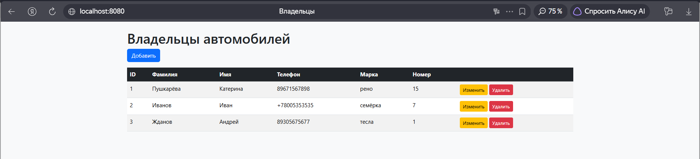
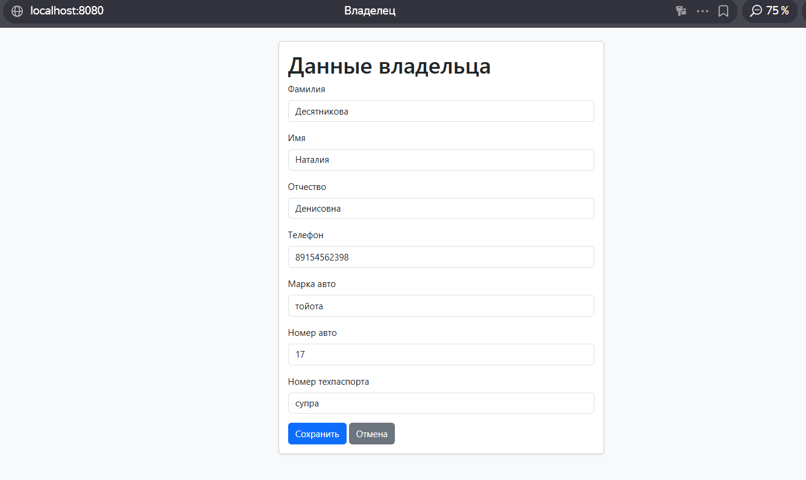
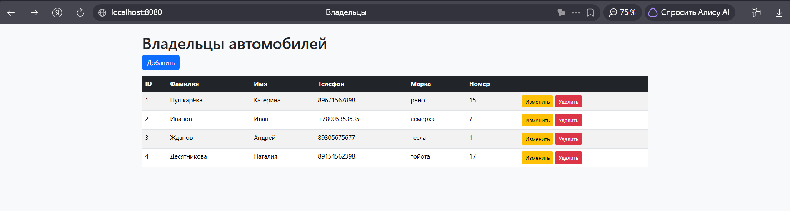

# Лабораторная работа №2. Репозиторий в Spring Data JPA

## Цель работы
Изучить использование репозитория в Spring Data JPA. Реализовать CRUD-приложение для работы с базой данных H2.

## Архитектура проекта
- **Стек:** Java 25, Spring Boot 4.1.1, Maven, Thymeleaf
- **СУБД:** H2 (встроенная, в памяти)
- **Основные слои:**
    - Controller (`CarOwnerController`) — обработка HTTP-запросов.
    - Repository (`CarOwnerRepository`) — интерфейс для работы с базой данных.
    - Model (`CarOwner`) — JPA-сущность (Владелец автомобиля).
- **Ключевые аннотации:**
    - `@Entity`, `@Table`, `@Id`, `@GeneratedValue` — для сущностей JPA.
    - `@Controller`, `@RequestMapping`, `@GetMapping`, `@PostMapping` — для контроллера.
    - `@ModelAttribute`, `@PathVariable` — для получения данных из формы и URL.
    - `@Autowired` — для внедрения репозитория.

## Алгоритм работы
1. При открытии `http://localhost:8080/owners/main` отображается список всех владельцев автомобилей.
2. При нажатии кнопки «Добавить» открывается форма ввода данных.
3. После заполнения формы данные отправляются методом POST на сервер и сохраняются в БД.
4. При нажатии кнопки «Изменить» открывается та же форма, но с заполненными полями.
5. При нажатии кнопки «Удалить» запись удаляется из БД по её ID.

## Скриншоты работы приложения

### Список владельцев

### Форма добавления

### Результат добавления
